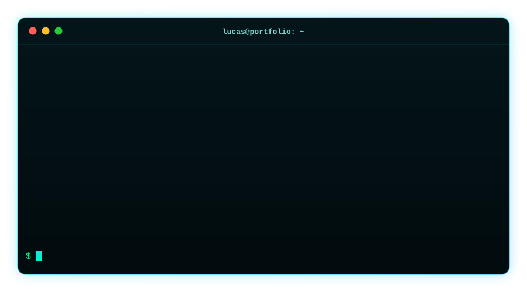

 

  

  

## 👋 Sobre

Sou desenvolvedor de software formado em **Desenvolvimento de Sistemas e Redes de Computadores** e curso **Desenvolvimento de Software Multiplataforma (DSM)** na **FATEC**, em São José dos Campos – SP.

Construo aplicações **Full Stack**, da interface ao banco de dados, com experiência acadêmica e prática em **APIs, autenticação, modelagem de dados e deploy em nuvem**. Gosto de entender como todas as camadas de uma solução se conectam, do back-end até a infraestrutura de rede.

**Foco atual:** React, TypeScript, Node.js e Astro, com interesse crescente em Cloud, DevOps, observabilidade e visualização de dados. Cuido também de qualidade: testes E2E, acessibilidade, desempenho e CI.

## 🚀 Meu portfólio

**[Abrir o portfólio ao vivo →](https://lucastec.vercel.app)**

Reconstruído do zero em **Astro 7 + TypeScript (strict)**, com tema claro/escuro, terminal interativo, sistema de conquistas, tour guiado, tradução PT/EN/ES e alguns segredos escondidos.

| ⚡ Desempenho | ♿ Acessibilidade | 🧪 Qualidade |
|:---:|:---:|:---:|
| De **6,9 MB** para **~480 KB** LCP de 15,8 s para **2,4 s** Lighthouse **98** (desktop) | Auditoria com **axe-core** Lighthouse **100** (desktop) Respeita `prefers-reduced-motion` | **Playwright** E2E · ESLint · Prettier **Lighthouse CI** · GitHub Actions **CodeQL** |

<b>🕹️ Experimente o terminal do portfólio</b>

 

Demonstração inspirada no terminal do site. No portfólio, abra o terminal e digite <code>ajuda</code> para ver todos os comandos. Tem um <code>matrix</code> por lá. 😉

## ⚙️ Stack

Mesma stack do meu <a href="https://lucastec.vercel.app">portfólio</a>. Clique em uma categoria para expandir.

<b>🎨 Frontend &amp; UI</b>

 

<b>💻 Linguagens de Programação</b>

 

<b>⚙️ Backend, APIs &amp; Segurança</b>

 

<b>🗄️ Banco de Dados &amp; ORM</b>

 

<b>☁️ Cloud, DevOps &amp; Observabilidade</b>

 

<b>🌐 Redes &amp; Infraestrutura</b>

 

<b>🧰 Ferramentas &amp; Versionamento</b>

 

<b>📊 Data Science &amp; Analytics</b>

 

<b>🤖 IA &amp; Modelos de Linguagem</b>

 

<b>🔌 IoT &amp; Blockchain</b>

 

## 🔎 Projetos em destaque

<table>
<tr>
<td width="50%" valign="top">

<h3>Aerocode</h3>
<b>Gestão da Produção Aeronáutica</b>

Autenticação, níveis de acesso, métricas de qualidade, filtros e histórico. Aplicação e API hospedadas em Vercel, Render e Aiven.

<code>React</code> <code>TypeScript</code> <code>Express</code> <code>Prisma</code> <code>MySQL</code>

</td>
<td width="50%" valign="top">

<h3>Signa</h3>
<b>Gestão de Requisitos Aeronáuticos</b>

Centralização de requisitos normativos com permissões, busca, filtros e controle de versões. Idealizado pela FATEC em parceria com a Akaer.

<code>React</code> <code>TypeScript</code> <code>Vite</code> <code>CSS</code>

</td>
</tr>
<tr>
<td width="50%" valign="top">

<h3>TaskMaster</h3>
<b>Gerenciador de Tarefas</b>

App moderno e responsivo com drag &amp; drop, temas claro e escuro AMOLED e animações sutis.

<code>React</code> <code>TypeScript</code> <code>Vite</code>

</td>
<td width="50%" valign="top">

<h3>Portfólio Gamer</h3>
<b>Currículo em formato de RPG</b>

Motor próprio de XP, level up, NPC interativo, inventário e áudio 8-bit gerado por código.

<code>HTML</code> <code>CSS</code> <code>JavaScript</code> <code>Firebase</code>

</td>
</tr>
</table>

<b>📂 Ver outros projetos</b>

 

| Projeto | Descrição | Tecnologias | Links |
|---|---|---|---|
| **Planet Spotter** | Exploração interativa de exoplanetas, criado no **NASA Space Apps Challenge** (atuação como Frontend Developer) | HTML, CSS, JavaScript | [Demo](https://nasasjc.vercel.app) · [Código](https://github.com/tirolasca/NASA) |
| **Janosys API** | Análise comparativa dos Censos 2010 e 2022 (projeto acadêmico FATEC) | Python, Flask, Pandas, Plotly | [Demo](https://janosysapi1.vercel.app) · [Código](https://github.com/janosystime/Janosys-Project) |
| **Vinícola Premium** | Site institucional elegante e responsivo para uma vinícola | HTML, CSS, JavaScript | [Demo](https://vinicolapremium.vercel.app) · [Código](https://github.com/tirolasca/Vinicola) |
| **CodeWave** | Página institucional de uma empresa de tecnologia | HTML, CSS, JavaScript | [Demo](https://codewavebr.vercel.app) · [Código](https://github.com/tirolasca/CodeWave) |
| **Tempero da Casa** | Cardápio digital responsivo com navegação por categorias | HTML, CSS, JavaScript | [Demo](https://temperodacasa.vercel.app) · [Código](https://github.com/DeveloperCorsair/Cardapio) |

## 📊 Atividade no GitHub

## 🎯 Objetivos

- Atuar profissionalmente como **desenvolvedor Full Stack**, contribuindo com projetos reais
- Aprofundar conhecimentos em **Cloud, DevOps e infraestrutura**
- Trabalhar com **arquiteturas modernas, APIs e bancos de dados**
- Desenvolver soluções envolvendo **dados, análise e visualização**

## 🤝 Vamos conversar?

Aberto a oportunidades, colaborações e conversas sobre tecnologia.

 

**Código limpo · Projetos reais · Aprendizado contínuo**

